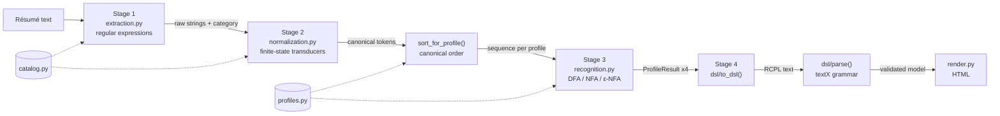

# Module design

## Architecture

`catalog.py` and `profiles.py` hold **data only**. Adding a fifth profile means
adding one `Profile(...)` object; no stage has to change.

## Modules, functions, inputs and outputs

| Module | Function / class | Input | Output |
|---|---|---|---|
| `catalog.py` | `LEXICON`, `CATEGORIES` | — | variants per canonical token and category |
| | `token_category(token)` | canonical token | category or `None` |
| `profiles.py` | `Profile`, `Slot`, `PROFILES` | — | the four profiles |
| | `Profile.canonical_sequence(tokens)` | list of tokens | tokens of the profile alphabet sorted by slot |
| | `Profile.missing_requirements(tokens)` | list of tokens | required slots not satisfied |
| `extraction.py` | `extract(text)` | résumé text | `ExtractionResult` (name, e-mails, phones, links, experience, jobs, education, skills) |
| | `extract_skills(text)` | text | `list[SkillMention]` (category, text as written, span) |
| | `ExtractionResult.save_json(path)` | path | JSON file |
| `normalization.py` | `build_transducer(category)` | category | `TransducerSpec` (explicit 7-tuple + pyformlang `FST`) |
| | `Normalizer.translate(raw, category)` | raw string | `(canonical token, transducer)` or `None` |
| | `Normalizer.normalize(items)` | raw strings | `NormalizationResult` (tokens, mapping, unrecognized) |
| | `sort_for_profile(tokens, profile)` | tokens, profile | canonical sequence |
| `recognition.py` | `build_dfa / build_nfa / build_enfa(profile)` | profile | `AutomatonSpec` (explicit 5-tuple + pyformlang automaton) |
| | `Recognizer.evaluate(tokens, key)` | tokens, profile key | `ProfileResult` (sequence, accepted, missing) |
| | `Recognizer.classify(tokens)` | tokens | `list[ProfileResult]` for the four profiles |
| `dsl/resume.tx` | textX grammar | — | metamodel |
| `dsl/__init__.py` | `to_dsl(extraction, normalization, results)` | results of stages 1–3 | RCPL text |
| | `parse(text)` / `parse_file(path)` | RCPL text | textX model (raises on invalid input) |
| `render.py` | `to_html(model)` | validated model | HTML page |
| `pipeline.py` | `ResumeLens.analyze(text)` | résumé text | `AnalysisResult` with every intermediate result |
| | `AnalysisResult.save(dir, stem)` | folder | `.extraction.json`, `.normalization.json`, `.classification.json`, `.resume`, `.html` |
| `cli.py` | `analyze`, `validate` | command line | console report + files |
| `app.py` | Streamlit UI | user text / upload | every stage on screen |
| `tools/generate_docs.py` | `main()` | implementation | `docs/generated/*.md`, `docs/diagrams/*.svg` |

## Data flow for the assignment example

| Stage | Data |
|---|---|
| Input | `Wednesday Addams / 3 years of experience developing web applications. / Technical Skills: JS, React.js, NodeJS, Postgres, Git.` |
| 1 | `JS`, `React.js`, `NodeJS`, `Postgres`, `Git` |
| 2 | `JAVASCRIPT`, `REACT`, `NODE_JS`, `POSTGRESQL`, `GIT` |
| sort (Full Stack) | `JAVASCRIPT REACT NODE_JS POSTGRESQL GIT` |
| 3 | Full Stack DFA: q0→q1→q2→q3→q5→q6 ∈ F → **ACCEPTED** |
| 4 | `samples/valid_wednesday_addams.resume` → validated → HTML |

## Error handling

* Strings found by Stage 1 but not recognised by any transducer are reported as
  `unrecognized` (never silently dropped).
* An empty canonical sequence is rejected without running the automaton.
* Stage 4 distinguishes `TextXSyntaxError` (lexical/syntactic) from
  `TextXSemanticError` (context-sensitive rules); the CLI returns exit codes 2
  and 3 respectively.
