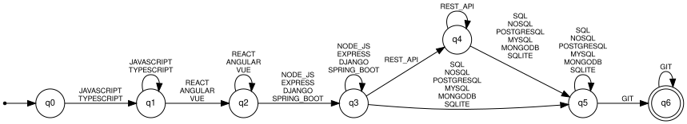
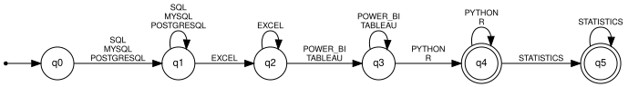
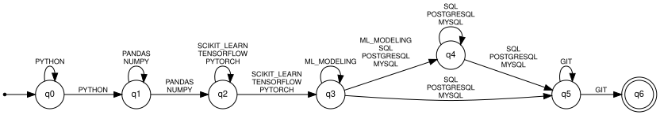
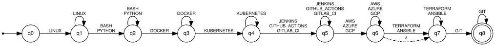

# Stage 3 — Qualification-pattern recognition with finite automata

Implementation: `resumelens/recognition.py` (pyformlang
`DeterministicFiniteAutomaton`, `NondeterministicFiniteAutomaton`, `EpsilonNFA`).
Complete 5-tuples of the four automata (Q, Σ, δ table, q0, F, type
justification, pattern): [`generated/automata.md`](generated/automata.md).

## Input alphabet

Σ of each automaton = the canonical tokens of the profile (the output alphabet Γ
of the transducers restricted to the profile). A résumé is a **word over Σ**:
its canonical sequence, e.g. `JAVASCRIPT REACT NODE_JS POSTGRESQL GIT`.

Choosing whole tokens as symbols (instead of characters) is a deliberate
abstraction level: Stage 2 already solved the lexical problem, so Stage 3 only
has to model *which combinations* of qualifications form a profile.

## Profile language

For slots S1..Sn with alternative sets A1..An:

    L(profile) = X1 X2 … Xn,     Xi = Ai⁺ if Si is required,  Xi = Ai* if optional

Example (ML Engineer):
`PYTHON⁺ (PANDAS|NUMPY)⁺ (SCIKIT_LEARN|TENSORFLOW|PYTORCH)⁺ ML_MODELING* (SQL|POSTGRESQL|MYSQL)⁺ GIT⁺`

The language is regular (it is a concatenation of Kleene closures of finite
sets), so a finite automaton is enough.

## One automaton per profile

Each profile is modelled by one automaton, and the three types seen in the
course are used. The constructions are generic functions that receive a
`Profile`, so the four automata come from the same code:

| Profile | Automaton | Builder | \|Q\| |
|---|---|---|---|
| Full Stack Developer | DFA | `build_dfa` | 7 |
| Machine Learning Engineer | NFA | `build_nfa` | 13 |
| DevOps Engineer | ε-NFA | `build_enfa` | 16 |
| Data Analyst | DFA | `build_dfa` | 6 |

### DFA — `build_dfa`

* Q = {q0, …, qn}; qi = "slots 1..i satisfied, last symbol read belongs to slot i".
* δ(qi, a) = qi for a ∈ Ai (repetition inside the slot).
* δ(qi, a) = qj for a ∈ Aj, j > i, when all slots between i and j are optional
  (this is how an optional slot is skipped without λ).
* F = {qi : every slot after i is optional}.

**Why it is a DFA:** the alternative sets of different slots are disjoint, so
each (q, a) has at most one successor and there are no λ-transitions. δ is
partial; to match the course definition δ : Q × Σ → Q (total) add a dead state
qd with δ(q, a) = qd for every missing pair and δ(qd, a) = qd. This does not
change the language.

### NFA — `build_nfa`

* Q = {q0, …, qn} ∪ {p1, …, pn}; pj = "inside slot j, more symbols of j follow".
* On a ∈ Aj the automaton **guesses**: δ(qi, a) = {qj, pj} ("a is the last
  symbol of slot j" or "not yet"); δ(pj, a) = {pj, qj}.
* F as in the DFA.

**Why it is an NFA:** δ : Q × Σ → ℘(Q) and there are pairs with two
successors, e.g. δ(q0, PYTHON) = {q1, p1}. There are no λ-transitions.

### ε-NFA — `build_enfa`

* Two states per slot: s_j (entering slot j) and t_j (slot j done),
  renamed q(2j) and q(2j+1).
* s_j —a→ t_j for a ∈ Aj; t_j —λ→ s_j (repeat the slot);
  t_j —λ→ s_{j+1} (next slot); s_j —λ→ t_j if the slot is optional.
* q0 = s_1, F = {t_n}.

**Why it is an ε-NFA:** δ : Q × (Σ ∪ {λ}) → ℘(Q) and there are λ-transitions,
e.g. δ(q1, λ) = {q0, q2}. This is the construction closest to the regular
expression (Thompson-style): each Ai⁺ is a small block, blocks are concatenated
with λ, optional blocks get a λ bypass.

## Worked examples

**Assignment example (ML Engineer, NFA):** input
`PYTHON PANDAS TENSORFLOW POSTGRESQL GIT`.
One accepting computation: q0 —PYTHON→ q1 —PANDAS→ q2 —TENSORFLOW→ q3
—POSTGRESQL→ q5 (skips the optional slot 4) —GIT→ q6 ∈ F → **ACCEPTED**.

**Repetition (Full Stack, DFA):** `TYPESCRIPT ANGULAR SPRING_BOOT REST_API
POSTGRESQL MONGODB GIT`: q0→q1→q2→q3→q4→q5→q5 (loop on MONGODB)→q6 ∈ F.

**Rejection (Full Stack, DFA):** Clark Kent `JAVASCRIPT VUE MYSQL GIT`:
q0→q1→q2, and δ(q2, MYSQL) is undefined (dead state) → **REJECTED**. The report
lists the missing requirement: *Node.js, Express, Django or Spring Boot*.

## Classification

`Recognizer.classify()` runs the four automata on the four canonical sequences
and returns one `ProfileResult` per profile. A résumé may satisfy several
profiles (Bruce Wayne: Full Stack and DevOps) or none (Clark Kent).

## Limitations

* The model is binary (accepted/rejected); it does not measure *how close* a
  candidate is — the list of missing requirements is computed separately.
* Requirements such as "at least 3 years with Kubernetes" relate two pieces of
  information and are not modelled.
* Only explicitly written qualifications count; the automaton cannot infer that
  someone who uses Django knows Python.
